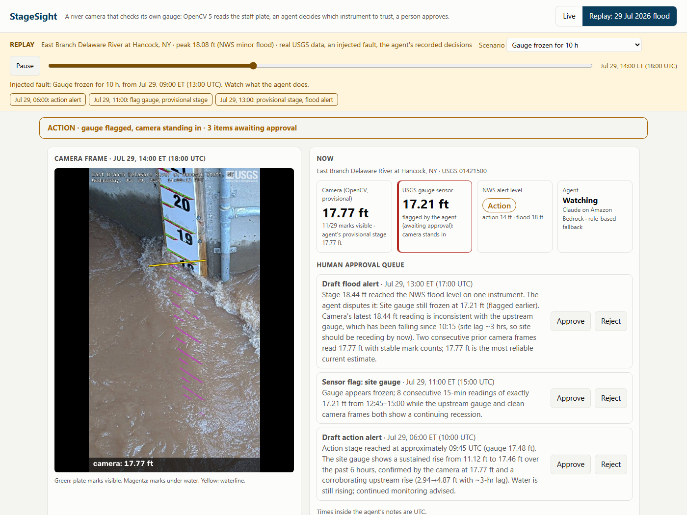

# StageSight: a river camera that checks its own gauge

OpenCV 5 reads the river stage off the staff plate in a USGS gauge camera, **with no gauge data**.
An agent (Claude on Amazon Bedrock) compares that reading with the gauge sensor, decides which
instrument is wrong, and queues sensor flags and flood alerts for a person to approve; approved
items are e-mailed through Amazon SNS. It runs live on AWS (Lambda on Graviton, EventBridge, S3,
SNS, Bedrock), its archive batch runs on EC2 Graviton4 with COOL, and the same code runs on a laptop CPU.

- **Demo video (4:55):** https://youtu.be/YnP3MDY5Bgs
- **Live dashboard:** https://zkdbpwl26gqzom5j3osjaoi4dy0htqoq.lambda-url.us-east-2.on.aws/
  When the river is low or it is night, it opens a replay of the 29 July 2026 flood with the agent's
  recorded decisions; pick a fault in the scenario menu. `?mode=live` shows the live camera.
- **Technical report:** [docs/StageSight_report.pdf](docs/StageSight_report.pdf) ([LaTeX source](docs/paper/stagesight.tex))




## Results

Hancock, NY (USGS 01421500), flood of 29 July 2026 (NWS minor flood, 18.08 ft peak). 30 daylight
frames with water on the plate, 27 of them above every frame used to train the baselines:

| Method | Gauge data | RMSE (ft) | Within 0.5 ft |
|---|---|---|---|
| **StageSight** (plate marks + OCR datum) | none | **0.26** (95% bootstrap 0.20 to 0.31) | **29 of 30** |
| Plate scale + offset fitted to the gauge | training | 0.37 | 25 of 30 |
| Linear pixel fit, trained on the 4–5 Sep high water | training | 6.31 | 7 of 30 |

**Second event, 4–5 Sep 2026 high water** (`results/hancock_plate_sep/`). The reader never used
these frames; only the baselines above were trained on them. 15 daylight frames, gauge 11.63 to
11.97 ft: RMSE 0.34 ft (95% bootstrap 0.29 to 0.38), bias +0.33 ft, 15 of 15 within 0.5 ft. The
water stayed inside one gap between two marks, so all 15 readings are the same 12.11 ft (the gap
midpoint): this is one measurement repeated, not 15 independent ones, and the error is the mark
spacing, not noise.

**Real degraded frames** (`results/hancock_real_faults/`). The 90-day archive has 87 daylight
frames with the gauge at or above 11 ft. None shows rain on the lens, fog or glare (checked by
eye; the quality gate rejected none), so real weather faults remain untested. The one real
failure is hydraulic: at 29 July 15:00 UTC a standing wave of whitewater ran up the plate and
the reader returned 17.77 ft against the gauge's 17.14 ft (+0.63 ft), the single July test frame
outside 0.5 ft. Over all 1,249 daylight frames at any stage, no frame was rejected or
unreadable; every `unreadable` frame in the archive is a night infrared frame.


Agent, replaying the same flood with injected faults, 3 runs per Claude model
(`results/agent/repeat_summary.json`, report Table IV):

| Fault | Rule baseline | Claude Opus 4.6 | Claude Sonnet 4.6 |
|---|---|---|---|
| Gauge offset +1 ft | caught, 1 h | 3/3, 1 h | 3/3, 1 h |
| Gauge silent 8 h | covered, 1 h | 3/3, 1 h | 3/3, 1 h |
| Gauge frozen 10 h | caught, 4 h | **3/3, 2 h** | 3/3, 2 h |
| Gauge drift to +1.5 ft | caught, 8 h | 3/3, 7 h | 1/3, 7 h |
| Debris over the plate (camera wrong) | blamed the healthy gauge | **3/3 blamed the camera** | 3/3 |
| Spray on the lens (camera wrong) | blamed the healthy gauge | **3/3 blamed the camera** | 3/3 |
| Healthy camera also flagged (all runs) | 0 | 3 | 5 |

Claude is not error-free: during the frozen gauge it also flagged the healthy camera at the second
peak, and there the flood alert came from the safety net. Over 90 days of normal operation (1,863
frames) both the rule planner and Claude Opus 4.6 raised 0 false sensor flags; each drafted the same
two alerts (action, then flood) at the real Jul 29 flood, and Claude used 17k input / 2.9k output
tokens (`results/agent_90d_claude/`). The reader gives a number for 2.4% of all
hourly frames: it reads floods; below the plate or at night it reports `below_plate` or
`unreadable` instead of guessing.

**COOL on Graviton4** (`results/cool/`, report Table II): with 16 worker processes a c8g.4xlarge reads
the whole 90-day archive (1,869 frames) in 4.1 s, about $0.0008 at on-demand prices, scaling almost
linearly from 33 frames/s with one worker. COOL 3.1 (OpenCV 5.1 + KleidiCV) gives the same status and
stage as pip OpenCV 5.0 in every frame, is 4% faster in one process and 4.9x faster in
`connectedComponentsWithStats`; the batch is NumPy-bound, so both builds tie there. COOL's DNN text
recognizer aborted on c8g.xlarge and ran on c8g.4xlarge (`scripts/cool_dnn_repro.py`).

## How it works
**Reader** (`stagesight/plate.py`, `stagesight/reader.py`)
- *Setup, once per camera, no gauge data* (`scripts/setup_site.py`): HSV red mask,
  `cv.connectedComponentsWithStats` and `cv.fitLine` find the plate and its marks; the foot marks give
  a 1-D projective map from pixels to feet (fit error 0.05 ft); the printed numbers, read with
  `cv.dnn.TextRecognitionModel` (OpenCV Zoo CRNN), give the datum (20 ft in 6 of 7 setup frames,
  `sites/hancock/site.json`).
- *Every frame*: quality gate; `cv.phaseCorrelate` re-registers the plate; each mark is visible or
  hidden by its Lab a* contrast against its surround; the waterline is the best visible/hidden split.

**Agent** (`stagesight/agent.py`): code raises an event (camera and gauge disagree, gauge silent,
camera blind in high water, NWS level reached); only then does Claude run a tool loop:
`reread_earlier_frames` (re-runs the OpenCV reader, with mark counts), `get_site_gauge`,
`get_upstream_gauge` (USGS 01417500), then `flag_sensor` or `draft_alert` (approval queue),
`publish_provisional_stage` or `no_action`. It also keeps agent memory, a safety net that always
surfaces flood alerts, a time budget, and a rule fallback on any model error.

**AWS** ([diagram](docs/figures/architecture.png)): EventBridge (15 min) → Lambda reader (arm64,
OpenCV 5, agent loop and tools; each hourly frame processed once) → Bedrock on events → private S3 →
Lambda API with a Function URL (dashboard, replay, `POST /measure`, `POST /approve` with an operator
token) → SNS e-mail after approval. Median tick 6.3 s, API 47 ms (CloudWatch).

## Check it in 10 minutes (fresh clone)
```bash
uv venv --python 3.12 && source .venv/bin/activate      # Windows: .venv\Scripts\activate
uv pip install -r requirements.txt pytest==8.4.2
pytest -q                                                 # plate reader on 2 real flood frames, agent, API
python scripts/serve_local.py --mode live                 # http://localhost:8000: live frame + built-in replay
```

## Reproduce every number
```bash
python scripts/download_site.py --cam NY_East_Branch_Delaware_River_at_Hancock_Staff --site 01421500 \
    --start 2026-07-21 --end 2026-10-20 --upstream 01417500 --out data/hancock
python scripts/flood_stress_test.py --index data/hancock/images.csv --gauge data/hancock/gauge.csv \
    --reference sites/hancock/reference.jpg --cache results/hancock_stack.npz \
    --test-start 2026-07-21 --test-end 2026-08-01 --no-align --out results/hancock_v2      # frame cache
python scripts/plate_test.py --cache results/hancock_stack.npz --reference sites/hancock/reference.jpg \
    --test-start 2026-07-21 --test-end 2026-08-01 --out results/hancock_plate             # Table III
python scripts/bootstrap_ci.py                                                           # RMSE 95% interval
python scripts/replay_agent.py --all --planner rules                                      # rule baseline
bash scripts/repeat_agent_runs.sh && python scripts/agent_stats.py                        # Table IV (Bedrock)
python scripts/replay_agent.py --scenario none --start 2026-07-21 --end 2026-10-19 --out results/agent_90d
python scripts/replay_agent.py --scenario none --start 2026-07-21 --end 2026-10-19 --planner claude --model global.anthropic.claude-opus-4-6-v1 --out results/agent_90d_claude
python scripts/cool_run.py --instance-type c8g.xlarge                                     # Table II (COOL; needs
python scripts/cool_run.py --instance-type c8g.4xlarge --scale && python scripts/cool_stats.py  # AWS + COOL subscription)
uv pip install -r requirements-dev.txt && python scripts/make_figures.py && python scripts/make_architecture.py
python scripts/build_replay.py                                                            # web/replay
cd docs/paper && latexmk -pdf stagesight.tex                                              # the report
```
`results/` holds the metrics, traces and summaries behind the report's numbers; the CloudWatch
latencies are the exception (read from the live functions).

## Deploy to AWS
```bash
python aws/build_package.py                                        # zip with Linux arm64 wheels and the replay
ALERT_EMAIL=you@example.org AGENT_BACKEND=bedrock bash aws/deploy.sh   # bucket, role, 2 functions, schedule, URL, SNS
```
The role can write logs, read and write only the project bucket, invoke Anthropic models on Bedrock
and publish to the one SNS topic. Failed ticks are not retried. The first deploy prints the operator
token that live approvals need; it is stored in the API function's environment.

## Repository map
| Path | What |
|---|---|
| `stagesight/plate.py`, `reader.py` | plate reader (report Sec. IV) |
| `stagesight/agent.py`, `service.py`, `world.py`, `storage.py`, `usgs.py` | agent, live tick and alerts, replay world, S3 or local store, USGS and NIMS clients |
| `stagesight/selfcal.py`, `vision.py`, `calibrate.py`, `scripts/flood_stress_test.py` | research mode for cameras without a plate (report Sec. VIII) and the frame cache |
| `aws/`, `web/` | Lambda handlers, build and deploy, dashboard and flood replay |
| `scripts/` | data download, setup, evaluation, repeated agent runs, COOL benchmark, figures |
| `results/`, `docs/` | evidence behind the numbers; report, figures, Devpost text |

## Limitations
Needs a plate with red marks in view and daylight; one reading resolves 0.1 to 0.8 ft, set by the
mark spacing; below the plate (about 11 ft) the camera cannot check the gauge. The Hancock camera
started in April 2026, so the 29 July flood is its only flood (the 4–5 Sep high water, a second
test event, stays inside one mark gap), and the camera faults in the agent evaluation are
synthetic: the archive has no daylight frame degraded by rain, fog or glare. StageSight is a decision aid, not an official warning system.

MIT licensed; third-party material in [NOTICE](NOTICE).
