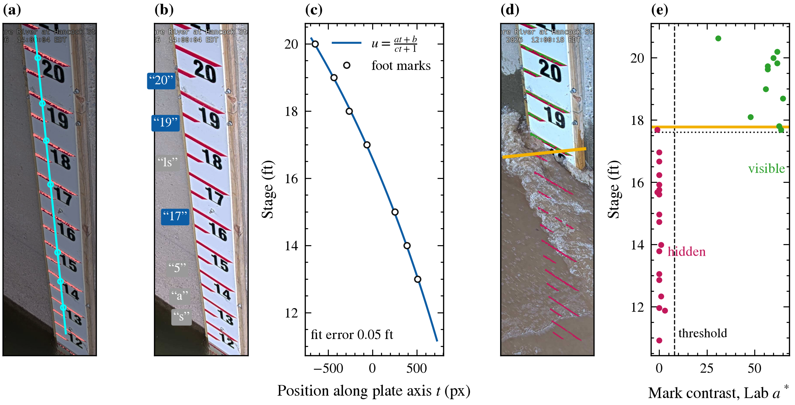
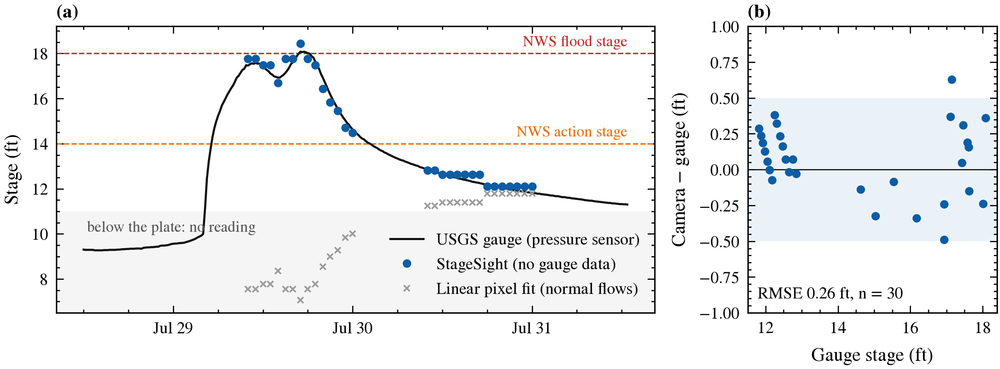

# StageSight: a river camera that checks its own gauge

OpenCV 5 reads the river stage off the staff plate in a USGS gauge camera, **with no gauge data**.
An agent (Claude on Amazon Bedrock) compares that reading with the gauge sensor, decides which
instrument is wrong, and queues sensor flags and flood alerts for a person to approve. Runs live
on AWS (Lambda on Graviton, EventBridge, S3, Bedrock) and, unchanged, on a laptop CPU.

**Technical report:** [docs/StageSight_report.pdf](docs/StageSight_report.pdf) (5 pages, [LaTeX source](docs/paper/stagesight.tex))
· **Live dashboard:** https://zkdbpwl26gqzom5j3osjaoi4dy0htqoq.lambda-url.us-east-2.on.aws/



## Results

Hancock, NY (USGS 01421500), flood of 29 July 2026 (NWS minor flood, 18.08 ft peak), 30 daylight
frames with water on the plate, 27 of them above anything seen in the normal-flow frames:

| Method | Gauge data | RMSE (ft) | Within 0.5 ft |
|---|---|---|---|
| **StageSight** (plate marks + OCR datum) | none | **0.26** | **97%** |
| Plate scale + offset fitted to the gauge | training | 0.37 | 83% |
| Linear pixel fit, trained on normal flows | training | 6.31 | 23% |



Agent, replaying the same flood with injected faults (single runs, `results/agent/`):

| Fault | Rule baseline | Claude Opus 4.6 |
|---|---|---|
| Gauge offset +1 ft / silent 8 h | caught, 1 h / 1 h | caught, 1 h / 1 h |
| Gauge frozen 10 h | caught, 4 h | **caught, 2 h** |
| Gauge drift to +1.5 ft | caught, 8 h | caught, 7 h |
| Debris over the plate (camera wrong) | blamed the healthy gauge | **blamed the camera** |
| Spray on the lens (camera wrong) | blamed the healthy gauge | **blamed the camera** |

Rule planner over 90 days of normal operation (1,863 replayed frames): 0 false sensor flags.
The reader returns a number for 2.4% of all hourly frames: the plate reads floods; below it, or
at night, it reports `below_plate` or `unreadable` instead of guessing.

## How it works
**Reader** (`stagesight/plate.py`, `stagesight/reader.py`)
- *Setup, once per camera, no gauge data* (`scripts/setup_site.py`): HSV red mask,
  `cv.connectedComponentsWithStats` and `cv.fitLine` find the plate and its marks; the foot marks
  give a 1-D projective map from pixels to feet (fit error 0.05 ft); the printed numbers, read with
  `cv.dnn.TextRecognitionModel` (OpenCV Zoo CRNN) and a vote, give the datum (20 ft, 6 of 7 votes).
- *Every frame*: quality gate; `cv.phaseCorrelate` re-registers the plate; each mark is visible or
  hidden by its Lab a* contrast against its surround; the waterline is the best visible/hidden split.

**Agent** (`stagesight/agent.py`): code raises an event (camera/gauge disagree, gauge silent,
camera blind in high water, NWS level reached); only then does Claude run a tool loop:
`reread_earlier_frames`, `get_site_gauge`, `get_upstream_gauge` (USGS 01417500), then
`flag_sensor` / `draft_alert` (approval queue), `publish_provisional_stage` or `no_action`.
Agent memory, a safety net that always surfaces flood alerts, and a rule fallback.

**AWS** ([architecture](docs/figures/architecture.png)): EventBridge (15 min) → Lambda reader
(arm64, OpenCV 5) → Bedrock on events → private S3 → Lambda API + Function URL (dashboard,
`POST /measure`, `POST /approve`). Median tick 6.3 s; API 47 ms.

## Run it
```bash
uv venv --python 3.12 .venv && uv pip install --python .venv/Scripts/python.exe -r requirements.txt
python tests/test_plate.py                                       # plate reader + agent, offline
python scripts/serve_local.py --mode replay --fault flatline     # dashboard at http://localhost:8000
python scripts/serve_local.py --mode live                        # live USGS camera
```

## Reproduce
```bash
python scripts/download_site.py --cam NY_East_Branch_Delaware_River_at_Hancock_Staff --site 01421500 --days 90 --out data/hancock
python scripts/flood_stress_test.py --index data/hancock/images.csv --gauge data/hancock/gauge.csv \
    --reference data/hancock/reference.jpg --cache results/hancock_stack.npz \
    --test-start 2026-07-21 --test-end 2026-08-01 --no-align --out results/hancock_v2      # frame cache
python scripts/plate_test.py --cache results/hancock_stack.npz --reference data/hancock/reference.jpg \
    --test-start 2026-07-21 --test-end 2026-08-01 --out results/hancock_plate             # accuracy table
python scripts/replay_agent.py --all --planner rules        # or --planner claude (AWS credentials)
python scripts/replay_agent.py --scenario none --start 2026-07-21 --end 2026-10-19 --out results/agent_90d
uv pip install --python .venv/Scripts/python.exe -r requirements-dev.txt
python scripts/make_figures.py                              # docs/figures/*.pdf|png
cd docs/paper && latexmk -pdf stagesight.tex                # report
```

## Deploy to AWS
```bash
python aws/build_package.py                  # 78 MB zip with Linux arm64 wheels, no Docker
AGENT_BACKEND=bedrock bash aws/deploy.sh     # bucket, IAM role, 2 functions, schedule, Function URL
```
The role can read/write only the project bucket and invoke Bedrock models. `POST /approve` is open
in this demo; put it behind authentication for operational use. `aws/Dockerfile` is an unused
container-image alternative.

## Repository map
| Path | What |
|---|---|
| `stagesight/plate.py`, `reader.py` | plate reader (the method in the report) |
| `stagesight/agent.py`, `service.py`, `world.py`, `storage.py`, `usgs.py` | agent, live tick, replay world, S3/local store, USGS/NIMS clients |
| `stagesight/selfcal.py`, `vision.py`, `calibrate.py`, `scripts/flood_stress_test.py` | self-calibrated mode for cameras without a plate (research, report §VIII) and the frame cache |
| `aws/`, `web/` | Lambda handlers, build and deploy scripts, dashboard |
| `results/` | metrics and agent traces behind every number |
| `docs/` | report, figures, Devpost text |

## Limitations
Needs a plate with red marks in view and daylight; readings step in 0.5 ft; below the plate
(~11 ft) the camera cannot check the gauge. The Hancock camera started in April 2026, so the
29 July flood is its only flood. StageSight is a decision aid, not an official warning system.

MIT licensed; third-party material in [NOTICE](NOTICE).
