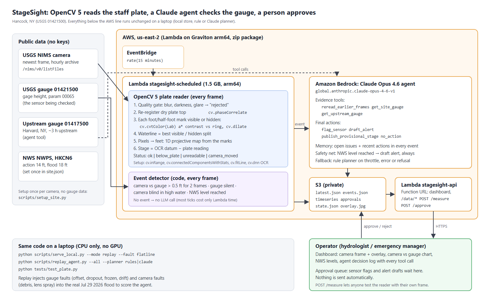
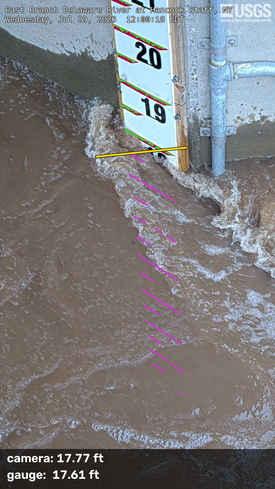
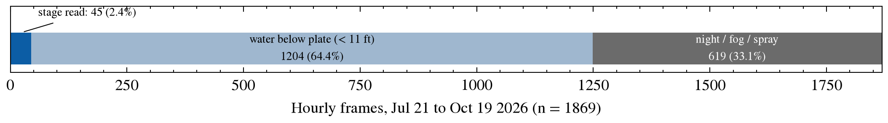
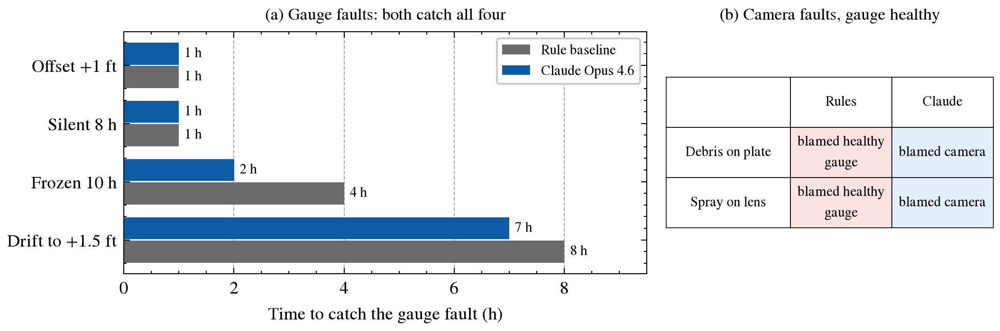

# Summary

A stream gauge reports river stage from one pressure sensor. When that sensor drifts, freezes
or goes silent, often during the flood it is needed for, nothing in the record says so. The
USGS already runs cameras at many gauges, but their images are looked at by people, not measured.

StageSight turns such a camera into a second, independent instrument:

- **OpenCV 5 reads the stage off the staff plate** in the image, with no gauge data: the plate's
  own marks give the scale, and the printed foot numbers, read by the OpenCV 5 DNN text
  recognizer, give the datum.
- **An agent compares camera and gauge.** When they disagree, the gauge goes silent or the
  river reaches an NWS flood level, Claude (Opus 4.6 on Amazon Bedrock) gathers evidence with
  tools and decides which instrument to trust. Sensor flags and alert drafts go to a person for
  approval; nothing is sent automatically.
- It runs **live on AWS** (Lambda on Graviton, EventBridge, S3, Bedrock) and, unchanged, on a laptop.

| Result | Value | Evidence |
|---|---|---|
| Camera vs USGS gauge, Jul 29 2026 flood (NWS minor flood, 18.08 ft peak) | **0.26 ft RMSE**, MAE 0.21 ft, bias +0.07 ft, **97% within 0.5 ft**, n = 30 | `results/hancock_plate/metrics.json` |
| Same flood, linear pixel fit trained on normal flows | 6.3 ft RMSE, 23% within 0.5 ft | same file |
| Injected gauge faults (offset, silent, frozen, drift) | caught by rules and by Claude; Claude faster on frozen (2 h vs 4 h) and drift (7 h vs 8 h) | `results/agent/*/all_scenarios.json` |
| Injected camera faults (debris, lens spray), gauge healthy | rules blame the healthy gauge in both; **Claude blames the camera in both** | same |
| 90 days of normal operation, rule planner | 0 false sensor flags; 2 alerts, both at the real flood | `results/agent_90d/rules/none/summary.json` |

# 1. Problem and users

- **Hydrographers** who check gauge records: a disagreement between camera and sensor points
  to the record that needs a site visit.
- **Emergency and floodplain managers** watching a few critical gauges during an event: when
  the sensor fails, the camera gives a provisional stage, labelled as such.
- **Gauge networks:** USGS NIMS lists 59 live cameras that look at a staff plate or gauge;
  each one could be read the same way.

Published camera methods measure stage but none uses the camera to check the gauge:

| Work | Method | Needs |
|---|---|---|
| Eltner et al. (2021), WRR, doi:10.1029/2020WR027608 | CNN water segmentation + photogrammetry | ground control points and a 3D model per site |
| Blanch et al. (2026), HESS 30:797, doi:10.5194/hess-30-797-2026 | same family, long-term operation | purpose-installed cameras and survey |
| Vandaele et al. (2021), HESS 25:4435, doi:10.5194/hess-25-4435-2021 | transfer-learned water segmentation | segmentation only, no fault checking |
| Xu and Wang (2025), Hydrology 12(4):65, doi:10.3390/hydrology12040065 | deep learning on webcam images for remote gauging | training labels from the gauge |
| **StageSight** | plate marks + OCR datum, classical OpenCV 5 + DNN text model | an existing USGS camera with a plate in view; no gauge data, no survey |

# 2. Data

- **Camera:** USGS NIMS API, `NY_East_Branch_Delaware_River_at_Hancock_Staff`, East Branch
  Delaware River at Hancock, NY (USGS 01421500). Hourly frames, Jul 21 to Oct 19 2026 (1,869
  frames). The camera started on Apr 14 2026, so the Jul 29 flood is its only flood.
- **Gauge:** USGS instantaneous gage height (parameter 00065), 15-minute data. Used **only for
  evaluation**, never by the reader.
- **Upstream gauge:** USGS 01417500, East Branch Delaware River at Harvard, NY (agent tool).
- **Flood levels:** NWS NWPS, HKCN6: action 14 ft, minor flood 18 ft.

All data are public; no keys are needed.

# 3. Architecture



- An EventBridge rule runs `stagesight-scheduled` (Lambda, arm64 Graviton, 1.5 GB) every 15
  minutes. It fetches the newest frame and gauge reading, runs the OpenCV 5 reader and the
  event detector, calls the agent only on an event, and writes the results to a private S3 bucket.
- `stagesight-api` (Lambda + Function URL) serves the dashboard and data from S3, takes
  approve/reject decisions and measures any frame posted to `/measure`.
- The deployment is a 78 MB zip built without Docker: `aws/build_package.py` cross-installs the
  Linux arm64 wheels of `opencv-python-headless` 5.0.0.93. `aws/deploy.sh` creates the bucket,
  a narrow IAM role (that bucket and `bedrock:InvokeModel*` only), both functions, the
  schedule and the URL, and is safe to re-run.

# 4. Reading the plate with OpenCV 5

{width=26%}

**Setup, once per camera, no gauge data** (`scripts/setup_site.py`):

1. **Find the plate.** HSV red mask (`cv.inRange`, `cv.morphologyEx`), red marks as
   `cv.connectedComponentsWithStats`, plate axis from `cv.fitLine` (Huber).
2. **Scale.** The foot marks are 1 ft apart on a straight plate, so pixel position $t$ along
   the axis maps to plate units by a 1D projective transform
   $u = (a t + b)/(c t + 1)$, fitted by linear least squares (fit error 0.05 ft). A pinhole
   camera maps a line to a line this way, so the form holds outside the fitted marks.
3. **Datum.** The plate is rotated upright (`cv.warpAffine`) and the printed foot numbers are
   read with the OpenCV 5 DNN `TextRecognitionModel` and the OpenCV Zoo CRNN model
   (`text_recognition_CRNN_EN_2021sep.onnx`). Reads vote; only two-digit reads may vote,
   because a dropped leading "1" is the usual misread. Result: 20 ft, 6 of 8 setup frames agreeing.

**Every frame** (`stagesight/plate.py`, `stagesight/reader.py`):

1. **Quality gate:** blur (Laplacian variance), darkness and glare → `rejected`.
2. **Registration:** the camera moves a few pixels between days; `cv.phaseCorrelate` on the
   always-dry plate top finds the shift (above 80 px → `camera_moved`).
3. **Mark visibility:** each mark is visible or hidden by its Lab a* contrast against a ring of
   plate around it (`cv.cvtColor`, `cv.dilate`). This holds in sun, shade and overcast; water
   and foam give no contrast.
4. **Waterline:** the best split between visible marks above and hidden marks below.
5. **Stage** = datum − plate reading at the waterline. If only the lowest mark is hidden the
   answer is ambiguous (wet or shaded at low water), so the status is `below_plate`.

The reader returns a number or a reason: `ok`, `below_plate`, `unreadable` (night infrared,
fog, spray), `rejected` or `camera_moved`. It never guesses.

# 5. Accuracy on a real flood


Test window: Jul 21 to Aug 1, daylight frames with the water on the plate (n = 30; 27 of them
above the highest stage seen in the 15 normal-flow frames used by the baselines).

| Method | Uses gauge data? | RMSE (ft) | MAE (ft) | Bias (ft) | Within 0.5 ft |
|---|---|---|---|---|---|
| **StageSight: plate scale + OCR datum** | **no** | **0.26** | **0.21** | +0.07 | **97%** |
| Plate scale + offset fitted to the gauge on normal flows | yes | 0.37 | 0.29 | −0.27 | 83% |
| Linear pixel fit trained on normal flows | yes | 6.31 | 4.70 | −4.70 | 23% |

- Readings step in 0.5 ft (the mark spacing), so ±0.25 ft is the floor of a single reading.
  0.26 ft RMSE is close to that floor.
- The learned fit fails because it never saw a flood; the plate reader needs no training range.
- Two fixture frames from this flood are regression tests (`tests/test_plate.py`):
  17.77 vs 17.61 ft and 12.63 vs 12.47 ft.

**Coverage, stated plainly.** Over 90 days the reader gave a number for 45 of 1,869 hourly
frames (2.4%). The water was below the plate bottom (about 11 ft) for 64% of frames, and 33%
were night infrared or fog. The plate is a flood instrument: it reads when the river is high,
which is when the gauge matters most.



# 6. The agent

OpenCV runs on every frame. **Claude is called only on an event** from code:

| Event | Trigger |
|---|---|
| `disagree` | camera and gauge differ by more than 0.5 ft for 2 frames |
| `gauge_silent` | the camera reads but the gauge has no recent reading |
| `camera_blind` | camera unreadable for 3 frames while the gauge is at or above action stage |
| `level_rise` | camera or gauge passes an NWS level (14 or 18 ft) |

**Tools** (evidence): `reread_earlier_frames` (re-runs the reader, with mark counts),
`get_site_gauge`, `get_upstream_gauge`. **Actions:** `flag_sensor` and `draft_alert` (both
go to the approval queue), `publish_provisional_stage`, `no_action`. Claude is called through
the Anthropic Bedrock client in a manual tool loop with adaptive thinking.

Design rules that came out of testing:

- **Memory:** open issues and the agent's recent actions are included in every event.
- **Safety net:** when an NWS level is reached on any instrument, a flood alert draft always
  reaches the person; if the agent doubted it, its doubt is written into the draft.
- **Fallback:** on throttling, an API error or a refusal, the rule planner decides and the log
  says so.
- **Human in the loop:** sensor flags and alerts wait in an approval queue on the dashboard.

## 6.1 Evaluation: injected faults on the real flood

`scripts/replay_agent.py` replays the Jul 29 flood frame by frame and injects faults. The
rule planner (same tools, fixed thresholds) is the baseline.



| Scenario | Rules | Claude Opus 4.6 |
|---|---|---|
| No fault | 0 false flags, alerts at 14 and 18 ft | same |
| Gauge offset +1 ft | caught, 1 h | caught, 1 h |
| Gauge silent 8 h | camera published, 1 h | camera published, 1 h |
| Gauge frozen 10 h | caught, 4 h | **caught, 2 h** |
| Gauge drifts to +1.5 ft over 12 h | caught, 8 h | caught, 7 h |
| Debris over the plate (camera reads 1 to 3 ft high) | **blamed the healthy gauge**, published the bad camera stage | **blamed the camera**, kept the gauge |
| Spray on the lens (camera reads ~2 ft high) | **blamed the healthy gauge**, published the bad camera stage | **blamed the camera**, kept the gauge |

Fixed thresholds cannot tell which instrument is wrong. In the debris case Claude noticed that
the number of visible marks dropped from 11 to 7 while both gauges said the river was falling,
and concluded that something covered the plate.

## 6.2 How the agent got there (reported in full)

1. **First run:** Claude missed the drift; it blamed the camera. Two facts an operator would
   know were added to the prompt: readings move in 0.5 ft steps, and upstream changes arrive
   about 3 h later (cross-correlation over 90 days).
2. **Second run:** all faults caught, but in the frozen-gauge case Claude forgot its own earlier
   gauge flag and **drafted no flood alert during a real flood.** The fix was in the system,
   not the prompt: agent memory and the safety net (section 6).
3. **Third run (tables above):** the safety net fired once, in the frozen-gauge case at 17:00.
   Claude reasoned from the 3 h lag that the river should be falling; this flood peaked about
   7 h after the upstream peak. The lag fact was not re-tuned to this flood.

Limits of this evaluation: one flood, one run per scenario, and the prompt facts were added
after seeing the first run on the same flood. The safety net and the approval queue exist
because the agent can be wrong.

**Model.** Claude Opus 4.6 (`global.anthropic.claude-opus-4-6-v1`) is the most capable
Claude model enabled on this new AWS account; the model is one environment variable.

# 7. Where it fails

| Case | What happens | Status |
|---|---|---|
| Night | infrared frames show the plate but not the red marks | `unreadable` |
| Low water (below ~11 ft) | the plate is dry | `below_plate`; the camera cannot check the gauge |
| Debris, spray | the reader is wrong | the agent blames the camera (section 6.1) |
| Other plate designs (Owasco, Moravia, Chenango NY) | black marks, 0.1 ft text, or plates on dry bank | not supported yet |
| Cameras without a plate | a self-calibrated mode (`stagesight/selfcal.py`) learns a per-pixel flood-stage map from the archive: 0.29 ft MAE in range on the Hancock wall, but it does not extrapolate to floods | research mode |
| Far-bank bridge cameras (Hermann MO, De Soto KS) | 2 to 3 px per ft; self-calibrated mode 3.4 ft and 2.3 ft RMSE in range | failure case |

Tried and not adopted: a sub-mark edge search (0.275 vs 0.257 ft RMSE); mark-bracket intervals
as uncertainty (only 23 to 50% coverage).

# 8. Responsible operation

- StageSight is a **decision aid, not an official warning system**. No message leaves the
  system without a person's approval; provisional stages are labelled as camera readings.
- Public data only; no personal data. The S3 bucket is private and the IAM role is limited
  to one bucket and Bedrock model invocation.
- Claude is called only on events, so a quiet day costs only Lambda time.
- Every agent decision, with its tool calls and reasons, is logged in `events.json` and shown
  on the dashboard.

# 9. Reproduce

```bash
uv venv --python 3.12 .venv && uv pip install --python .venv/Scripts/python.exe -r requirements.txt
python tests/test_synthetic.py && python tests/test_plate.py
python scripts/plate_test.py ...          # accuracy (full commands in README.md)
python scripts/replay_agent.py --all --planner rules     # or --planner claude (AWS credentials)
python scripts/make_figures.py            # figures in docs/
python aws/build_package.py && AGENT_BACKEND=bedrock bash aws/deploy.sh
```

Pinned versions: `opencv-python-headless` 5.0.0.93, `numpy` 2.5.4, `anthropic[bedrock]` 1.15.0,
`boto3` 1.43.114, Python 3.12.

# 10. Next

- Read night infrared frames from the printed numbers instead of the red marks.
- More plate designs, then the other NIMS plate cameras.
- Repeat the agent runs to report catch rates instead of single runs.

# References

- Blanch, X., Grundmann, J., Hedel, R., and Eltner, A. (2026). AI image-based method for a robust automatic real-time water level monitoring: a long-term application case. *Hydrology and Earth System Sciences*, 30, 797. doi:10.5194/hess-30-797-2026
- Eltner, A., Bressan, P. O., Akiyama, T., Gonçalves, W. N., and Marcato Junior, J. (2021). Using deep learning for automatic water stage measurements. *Water Resources Research*. doi:10.1029/2020WR027608
- Vandaele, R., Dance, S. L., and Ojha, V. (2021). Deep learning for automated river-level monitoring through river-camera images: an approach based on water segmentation and transfer learning. *Hydrology and Earth System Sciences*, 25, 4435. doi:10.5194/hess-25-4435-2021
- Xu, R., and Wang, B. (2025). Assessing deep learning techniques for remote gauging and water quality monitoring using webcam images. *Hydrology*, 12(4), 65. doi:10.3390/hydrology12040065
